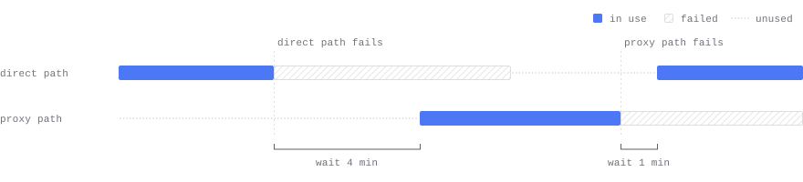

# Tailspace in depth

The [README](README.md) covers the usual install. This page covers everything else: auth keys, SSH, how Tailspace keeps your server online, commands and settings, proxies and relays, reaching your other devices from the server, and reference details.

English · [简体中文](ADVANCED.zh-CN.md)

## Installing with an auth key

If you set up servers from a script, or just don't want to open a browser, install with an auth key. If the key carries a tag, the server also never has to log in again, because Tailscale turns off key expiry for tagged devices.

1. Define the tag in your [access control policy](https://login.tailscale.com/admin/acls/file). The easiest way is to replace the policy with [`examples/policy.hujson`](examples/policy.hujson), which defines `tag:server`, lets everyone in your tailnet SSH into tagged servers, and keeps tagged servers from connecting to your other devices. If you've customized your policy, copy over only the parts you need.
2. [Generate an auth key](https://login.tailscale.com/admin/settings/keys) with the tag `tag:server`. Make it reusable if you'll use it on more than one server, and keep it secret, since anyone who has it can add devices to your tailnet.
3. Install with the key, and give the server a name:

```bash
curl -fsSL https://raw.githubusercontent.com/ttttonyhe/tailspace/main/tailspace | TS_AUTHKEY=tskey-auth-... bash -s -- install --hostname lab-07
```

Passing the key in `TS_AUTHKEY` keeps it off the process list, where other users on the server could see it. To keep it out of your shell history too, save it to a file only you can read and pass `TS_AUTHKEY=file:/path/to/key`.

## SSH

Tailspace turns on Tailscale SSH, so you log in with your Tailscale identity instead of SSH keys. Tailscale SSH takes port 22. If the server also runs OpenSSH, Tailspace makes it available on port 2222, unless a program of yours already takes 127.0.0.1:2222, so `ssh -p 2222 you@lab-07` still works with your usual keys and config. OpenSSH sees each of those connections coming from the server itself, though, so its logs, `from=` limits in `authorized_keys` and tools that ban addresses can't tell your devices apart. Tailscale SSH knows who connected.

Tailscale's default policy runs Tailscale SSH in check mode, which asks you to log in again in the browser every 12 hours. To skip that, change `"check"` to `"accept"` in the policy's `ssh` rule.

Every other port goes straight to the server. A Jupyter notebook listening on port 8888, for example, is at `lab-07:8888`.

Restarting Tailscale ends every session over Tailscale: your SSH sessions, connections to programs on the server such as that notebook, and connections the server opens to your other devices. Tailspace puts off the restarts that can wait, such as updates, while it sees sessions open, for 3 days at most, as [Updates](#updates) explains. Still, run long jobs in tmux or screen, so a dropped connection never costs you work.

## How Tailspace keeps the server online

A normal Tailscale install runs as a system service, which the operating system starts at boot and restarts after a crash. Without root, Tailspace does that job with a small supervisor process that runs next to Tailscale. In the process list, Tailscale is `tailscaled` and the supervisor is `tailspace`.

### Crashes and reboots

If Tailscale crashes, the supervisor restarts it 5 seconds later.

A reboot takes the supervisor down too, and without root Tailspace can't register a service that starts at boot. Instead, it brings the supervisor back in two ways that a normal account can set up. If the server runs cron, a cron job starts the supervisor at boot and checks on it every 5 minutes. And a short check in your shell startup files, such as `~/.bashrc`, starts it whenever you open a shell on the server. The check runs in the background and adds less than a millisecond to each new shell.

So on a server without cron, Tailspace comes back the first time you log in after a reboot. Log in the way you did before you had Tailspace, for example through the cluster's own SSH or `kubectl exec`.

### Network outages and proxies

Tailscale is online while it can reach its coordination server, the service that manages your tailnet. Most servers reach it directly. Some also have an HTTP proxy, because their direct connection is slow or blocked for some sites. In mainland China, such a proxy often runs over a VPN that drops now and then. Tailspace calls these two ways out the direct path and the proxy path.

Tailscale reads its proxy setting only when it starts, so it can't switch paths by itself. When the path in use stops working and the other one works, the supervisor restarts Tailscale on the other path.

<picture>
  <source media="(prefers-color-scheme: dark)" srcset="assets/paths-dark.svg">
  
</picture>

Before switching, the supervisor gives Tailscale a chance to recover on its own, 4 minutes on the direct path and 1 minute on the proxy path. If both paths are down, it checks every minute and uses whichever comes back first. It prefers the direct path, since on the proxy path your server is only as reliable as the proxy. After switching to the proxy path, it switches back once the direct path has been working steadily again, at the earliest 20 minutes later. Because switching restarts Tailscale, it also waits until no session over Tailscale is open, for 3 days in all. Leaving a path that stopped working doesn't wait for anyone to disconnect.

<details>
<summary>The exact rules</summary>

- Every 20 seconds, the supervisor asks Tailscale for its state. If Tailscale doesn't answer three times in a row, the supervisor restarts it.
- When Tailscale goes offline, the supervisor waits 4 minutes on the direct path, which covers Tailscale's own reconnection attempts, or 1 minute on the proxy path.
- It then tests the path in use by opening a fresh connection to the coordination server with `tailscale debug ts2021`. If that fails, it tests the other path and switches if that one works. If the path in use passes two tests in a row while Tailscale stays offline, Tailscale is stuck, and the supervisor restarts it on the same path. If neither path works, it tests again every minute.
- After any other restart, including a restart of Tailspace itself, the supervisor stays on the path it was using as long as that path works.
- After switching to the proxy path, the supervisor waits 15 minutes, then tests the direct path every 5 minutes. It switches back as soon as two tests in a row pass while Tailscale is online, and either no session over Tailscale is open or sessions have held it back for 3 days in all. If the direct path fails again within 30 minutes of switching back, that 15-minute wait doubles, up to 4 hours.

</details>

### Updates

Once a day, the supervisor checks for a new version of Tailscale. If there is one, it installs it, restarts Tailscale, and waits for Tailscale to come back online within 2 minutes and stay up for 30 seconds. If it doesn't, Tailspace rolls back to the previous version and won't install that version automatically again. If the supervisor can't tell, for example because the network is down or you stopped Tailspace, it rolls back and tries the new version again a day later.

While a session over Tailscale is open, the supervisor holds a new version back, because installing it restarts Tailscale. It sees SSH sessions, connections that Tailscale hands to programs on 127.0.0.1 or ::1, and `tailscale` commands that stay connected to Tailscale, such as `tailscale nc` or `tailscale serve` in the foreground. It doesn't see a serve forward to a Unix socket or to another address, and it sees a Tailscale SSH session that runs no shell, such as `ssh -N -L 8888:localhost:8888 you@lab-07`, only while that session forwards a connection to 127.0.0.1 or ::1. The supervisor checks again every hour, and after 3 days it updates anyway, so a server that's never idle still gets fixes. `tailspace status` shows when an update is waiting, and `tailspace update` installs it right away.

### When Tailspace gives up

Some problems need a person, and retrying would only waste resources. When the server has to log in again, when adding it to your tailnet fails, or when Tailscale fails 5 times in a row, Tailspace stops Tailscale and the supervisor, and `tailspace status` tells you why:

| Status says | What happened | What to do |
| --- | --- | --- |
| stopped with `tailspace stop` | You stopped Tailspace | Run `tailspace start` |
| this server must log in again | Its key expired, or someone removed it from your tailnet | Run `tailspace install` again |
| adding this server to your tailnet failed | The auth key was expired or used up, or your policy doesn't define its tag | Run `tailspace install` with a valid auth key |
| Tailscale failed 5 times in a row | Tailscale crashed, hung, or stayed offline while the network worked, 5 times in a row | Check `tailspace logs`, then run `tailspace start` |
| no reason was saved | The disk was full when Tailspace stopped, so it couldn't write down why. Like a stop, this holds across reboots | Free some space, then run `tailspace start` |

Tailspace then stays stopped until you start it again, with one exception. If it stopped because the server had to log in again or Tailscale kept failing, the shell check and the cron job start it again after the server reboots, because a reboot can clear the cause. On a Kubernetes pod that keeps its name and its home directory, restarting the pod counts as a reboot.

That also gives you a way back to a server whose key expired when you have no other way to reach it. On the Machines page of the admin console, choose Temporarily extend key for the server, and within the 30 minutes the extension lasts, disable key expiry for it. If the console offers Reauthorize machine instead, the server has already started a new login; see Tailscale's [key expiry](https://tailscale.com/kb/1028/key-expiry) page. Then reboot the server, or wait for its next reboot. If `tailspace status` listed crontab under Autostart when you last checked, the server's cron daemon brings it back online on its own; otherwise it comes back when someone logs in.

## Commands

| Command | What it does |
| --- | --- |
| `tailspace status` | Shows whether Tailspace is running, which path it's on, and what it did recently |
| `tailspace stop` | Stops Tailscale and the supervisor, and keeps them stopped across reboots |
| `tailspace start` | Starts them again |
| `tailspace restart` | Restarts them. It finishes even if you run it over Tailscale SSH, whose connection drops during the restart |
| `tailspace set --no-ssh` | Changes a setting, in this case turning Tailscale SSH off. See [Settings](#settings) |
| `tailspace update` | Updates Tailscale now |
| `tailspace update 1.104.6` | Installs that version of Tailscale and turns off daily updates |
| `tailspace logs -f` | Follows the log, like `tail -f` |
| `tailspace self-update` | Updates Tailspace itself |
| `tailspace uninstall` | Logs the server out of your tailnet and removes Tailspace |

Tailspace also installs a `tailscale` command, the standard Tailscale CLI, set up to talk to the Tailscale that Tailspace runs. For example, `tailscale status` lists the devices in your tailnet.

## Settings

`tailspace install` and `tailspace set` take these options. `set` changes a setting without reinstalling, and running the install again keeps your earlier choices.

| Option | Default | Meaning |
| --- | --- | --- |
| `--authkey KEY` | | The auth key, or `file:PATH` to read it from a file. Install only. `TS_AUTHKEY` is safer, since other users on the server can see the commands you run |
| `--tags TAGS` | | Tags for the server, such as `tag:server`. Install only. Required with an OAuth client secret, which you can use instead of an auth key |
| `--version VERSION` | latest | Installs this version of Tailscale and turns off daily updates. Install only |
| `--hostname NAME` | the server's hostname | The server's name in your tailnet |
| `--proxy URL` | `https_proxy` at the first install | The HTTP proxy for the proxy path, or `none` |
| `--udp-port PORT` | 0, any free port | The UDP port for direct connections to other devices, from 1024 to 65535. Pick one if you need to open it in a firewall |
| `--[no-]autostart` | on | The shell check and cron job that bring Tailspace back after a reboot |
| `--[no-]auto-update` | on | Daily Tailscale updates, as [Updates](#updates) describes |
| `--[no-]ssh` | on | Tailscale SSH on port 22, and OpenSSH on port 2222. When off, port 22 goes to OpenSSH |
| `--[no-]log-upload` | on | Sends Tailscale's diagnostic logs to Tailscale |

To install somewhere other than `~/.tailspace`, for example because your home directory doesn't allow running programs, set `TAILSPACE_PREFIX` when you install. Later commands find the new location on their own.

```bash
curl -fsSL https://raw.githubusercontent.com/ttttonyhe/tailspace/main/tailspace | TAILSPACE_PREFIX=/scratch/$USER/tailspace bash
```

## Servers behind a proxy

If the server needs an HTTP proxy to reach the internet, make sure `https_proxy` is set before you install, so the installer can download Tailspace and Tailscale:

```bash
export https_proxy=http://127.0.0.1:7890
curl -fsSL https://raw.githubusercontent.com/ttttonyhe/tailspace/main/tailspace | bash
```

The first install saves that proxy for the proxy path. Tailscale still starts on the direct path whenever it works, as [Network outages and proxies](#network-outages-and-proxies) explains. To change or remove the proxy later, run `tailspace set --proxy http://HOST:PORT` or `tailspace set --proxy none`.

Only `http://` proxies work. Tailscale treats every proxy as an HTTP proxy, even one written as `socks5://`, and it ignores `ALL_PROXY`.

## Direct connections and relays

Tailscale connects your devices to the server directly whenever it can. When it can't, usually because the server sits behind a hard NAT or firewall, or reaches the internet only through a proxy, the traffic goes through a peer relay, if you've set up one that both devices can reach, or else through one of Tailscale's DERP relays. DERP relays are slower, because Tailscale limits their bandwidth and they may be far away. `tailspace status` tells you when a device that's active right now reaches the server through a DERP relay, and its device list shows `relay` next to that device.

Two Tailscale features can bring a relay closer:

- [Your own DERP server](https://tailscale.com/kb/1118/custom-derp-servers), run near the server, helps on both paths. It doesn't need a domain name, because `derper --certmode manual --hostname IP` makes its own certificate and prints the lines to add to your policy. Start it with `--verify-clients` so only your tailnet can use it, which requires Tailscale on the same machine.
- [Peer relays](https://tailscale.com/docs/features/peer-relay), in Tailscale 1.86 and newer, let one of your own devices relay for the others. They use UDP, which HTTP proxies don't carry, so they help only when the server can send UDP out directly.

Userspace networking, which lets Tailscale run without root, is rarely what slows you down. On a Kubernetes pod running Tailscale 1.104.7, it moved about 10 Gbit/s over one connection to the pod's own tailnet address, a test that leaves out WireGuard and the network.

## Connecting from the server to other devices

A normal Tailscale install adds a virtual network interface, which any program can use to reach your other devices. Without root there's no such interface, so programs on the server have to go through `tailscale nc`. For SSH, add a device to `~/.ssh/config` once:

```text
Host lab-01
  User you
  Port 2222
  ProxyCommand tailscale nc %h %p
```

Then `ssh lab-01` logs in with your usual keys to the OpenSSH that another Tailspace server makes available on port 2222, and `scp`, `rsync` and `git` reach it by name too. Programs that can't go through `tailscale nc`, such as curl or a browser, can't reach your tailnet. MagicDNS names like lab-01 resolve only inside Tailscale, and `ping` doesn't reach your devices, though `tailscale ping lab-01` does. Tailscale also has SOCKS5 and HTTP proxies for such programs, but Tailspace leaves them off. They have no password, so on a shared server every other user could use them to reach your devices.

If the server is tagged, the example policy blocks connections like these, because it keeps tagged servers from connecting to your other devices. To let your servers reach each other, uncomment the line in the policy that allows `tag:server` to reach `tag:server`.

## Reference

### Files

```text
~/.tailspace/
  tailspace           Tailspace itself; the shell check and cron job run this copy
  bin/                the tailscale and tailscaled binaries
  bin.prev/           the previous Tailscale version, for rolling back
  config              your settings
  bad-version         a version that failed after an update
  state/HOSTNAME/     everything that belongs to one server
    tailscaled.state  the server's identity in your tailnet
    tailscaled.log    the log, started over after 10 MB
~/.local/bin/         the tailspace and tailscale commands
```

The shell check sits between two marker comments in your shell startup files, and the same lines put `~/.local/bin` on your `PATH` so new shells find the `tailspace` command. On servers with cron, your crontab gets two lines for the cron job.

Each server keeps its state in its own directory under `state/`, named after its hostname. So servers that share a home directory, as cluster nodes often do, can share one `~/.tailspace`. Run `tailspace install` once on each of them, and each one joins your tailnet as its own device, while they all share the binaries, settings and shell check. A server whose hostname changes, such as a Kubernetes pod recreated under a new name, counts as a new server and needs `tailspace install` again, so use a reusable auth key for those.

### Uninstall

`tailspace uninstall` logs the server out of your tailnet, stops Tailspace, and removes its files, commands, shell check and cron job. The server stays on the Machines page of the admin console until you remove it there. If Tailspace isn't running, uninstall can't log the server out, and tells you so. If other servers still use the same `~/.tailspace`, it keeps what they need.

### Troubleshooting

Start with `tailspace status`, and check `tailspace logs` for details.

- **The install can't reach controlplane.tailscale.com.** The server needs a proxy. See [Servers behind a proxy](#servers-behind-a-proxy).
- **Tailscale SSH refuses you.** Make sure your policy has an `ssh` rule that allows you, like the one in the example policy, and connect as the account that installed Tailspace.
- **Nothing is running after a reboot.** The server has no cron, and nobody has logged in since the reboot. Log in once the way you did before Tailspace.
- **Transfers are slow, or typing lags.** Your device may reach the server through a DERP relay, which `tailspace status` points out. See [Direct connections and relays](#direct-connections-and-relays).
- **The install says the downloaded tailscaled doesn't run.** Your home directory doesn't allow running programs. Install somewhere else with `TAILSPACE_PREFIX`.
- **The install says file locks don't work, or a path is too long.** Install to a short path on a local disk with `TAILSPACE_PREFIX`.

### Requirements

- Linux 3.2 or newer, including CentOS 7, on x86_64, arm64, 32-bit ARM, 386 or riscv64
- bash 4.2 or newer, and curl or wget
- `awk`, `flock`, `setsid` and `timeout`, which almost every distribution includes
- A normal account on the server

### Security

- If the server belongs to a shared cluster, check its rules first. Tailspace keeps Tailscale running in the background, and Tailscale SSH skips the cluster's own two-factor check. Some clusters forbid one or both.
- Tailscale runs as you, so it can do whatever your account can do and nothing more. Only you can get into `~/.tailspace`, which holds the socket that controls Tailscale. Tailspace also leaves Tailscale's proxies off, so other users on the server can't use your tailnet.
- Tailscale hands every connection to the server's tailnet IP to the same port on 127.0.0.1, unless something takes the port first: Tailscale SSH takes 22 while it's on, Tailspace's forward to OpenSSH takes 2222, and a `tailscale serve` forward takes the port you give it. So any program listening on 127.0.0.1 or on all addresses, yours or another user's, is reachable from the devices your policy allows, even one that listens only on 127.0.0.1 because it trusts everyone who can reach that address.
- Tailscale SSH only logs people in as your account, and your policy decides who can connect. The example policy lets everyone in your tailnet in, so if you share your tailnet, replace `autogroup:member` in its `ssh` rule with your own login name.
- New Tailscale versions come from `pkgs.tailscale.com` over HTTPS, and HTTPS is the only check of where they come from. A new version only stays if it runs and comes back online, as [Updates](#updates) describes. Tailspace never updates itself on its own; `tailspace self-update` downloads the latest Tailspace from this repository's `main` branch and runs it.

### The example policy

Besides `tag:server` and the SSH rules, [`examples/policy.hujson`](examples/policy.hujson) turns on `cache-network-maps` for tagged servers. Each server then keeps a copy of what it knows about your other devices, so after a restart it can reach them before the coordination server answers. This needs Tailscale 1.104 or newer, and `tailspace status` reminds you while it's off. See [client-side netmap caching](https://tailscale.com/docs/reference/client-side-netmap-caching).

### What Tailspace changes in Tailscale

Tailspace starts Tailscale with a few tweaks that suit servers without root:

| Change | Why |
| --- | --- |
| `GOMAXPROCS=8` when more than 8 cores are available | Tailscale is written in Go, which by default runs one thread per core. On a 124-core pod, this cut Tailscale from 57 threads to 14, and the CPU time of each state check from 57 ms to 15 ms |
| `TS_PORTLIST=false` | Stops Tailscale from scanning the server's open ports every second, for a list only the admin console shows |
| TCP keepalives after 60 s idle, then every 15 s | Connections to devices that vanished close within minutes instead of two hours |
| UDP GSO off in containers | GSO sends UDP packets in batches, which cripples throughput on some container networks. See [#20858](https://github.com/tailscale/tailscale/issues/20858) |
| `GODEBUG=tlsmlkem=0` | Some networks drop TLS handshakes that use ML-KEM, a new kind of key exchange. See [#20777](https://github.com/tailscale/tailscale/issues/20777). Tailscale's own encryption still protects all traffic |

Two settings stay at Tailscale's defaults. Tailspace doesn't turn on RACK, a packet loss recovery feature, because it stalled connections and Tailscale 1.104.5 turned it off. See [#21946](https://github.com/tailscale/tailscale/issues/21946). Tailspace also keeps log upload on, because tailnets with network flow logs turned on take devices that don't upload logs offline.
