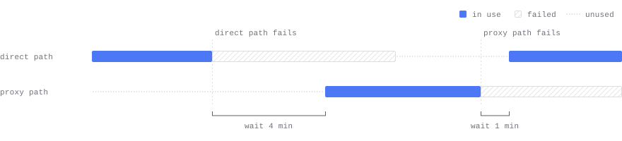

# Tailspace 详解

[README](README.zh-CN.md) 介绍了常规安装。本文介绍其余的一切：auth key、SSH、Tailspace 如何让服务器保持在线、命令与设置、代理与中继、从服务器连接你的其他设备、常见运行环境、与手动 userspace 方案的对比，以及参考信息。

[English](ADVANCED.md) · 简体中文 · [指南与文档](https://ttttonyhe.github.io/tailspace/zh/)

## 用 auth key 安装

如果你用脚本部署服务器，或者只是不想打开浏览器，可以用 auth key 安装。如果 key 带有标签，服务器以后也不用重新登录，因为 Tailscale 默认为带标签的设备关闭密钥过期。

1. 在你的[访问控制策略](https://login.tailscale.com/admin/acls/file)里定义这个标签。最简单的做法是用 [`examples/policy.hujson`](examples/policy.hujson) 替换现有策略。它定义了 `tag:server`，允许 tailnet 里的所有人 SSH 到带标签的服务器，并禁止带标签的服务器连接你的其他设备。如果你改过自己的策略，只复制需要的部分即可。
2. [生成一个 auth key](https://login.tailscale.com/admin/settings/keys)，标签选 `tag:server`。如果要在多台服务器上使用，记得勾选 Reusable。请妥善保管它，任何拿到它的人都能往你的 tailnet 里添加设备。
3. 用这个 key 安装，并给服务器起个名字：

```bash
curl -fsSL https://raw.githubusercontent.com/ttttonyhe/tailspace/main/tailspace | TS_AUTHKEY=tskey-auth-... bash -s -- install --hostname lab-07
```

用 `TS_AUTHKEY` 传入 key，它就不会出现在进程列表里，服务器上的其他用户也就看不到。如果还不想让它留在 shell 历史里，就把它存进一个只有你能读的文件，然后传 `TS_AUTHKEY=file:/path/to/key`。

## SSH

Tailspace 会开启 Tailscale SSH，你用 Tailscale 身份登录，不需要 SSH 密钥。Tailscale SSH 占用 22 端口。如果服务器上还运行着 OpenSSH，Tailspace 会让它在 2222 端口上可用，除非你的某个程序已经占用了 127.0.0.1:2222，所以 `ssh -p 2222 you@lab-07` 依然可以用你平时的密钥和配置。不过 OpenSSH 看到的这些连接都来自服务器本机，所以它的日志、`authorized_keys` 里的 `from=` 限制，以及按地址封禁的工具，都分不清是你的哪台设备。Tailscale SSH 则知道是谁连了进来。

Tailscale 的默认策略让 Tailscale SSH 以 check 模式运行，每 12 小时要你在浏览器里重新登录一次。不想这样，就把策略 `ssh` 规则里的 `"check"` 改成 `"accept"`。

其他端口都直通服务器。比如服务器上监听 8888 端口的 Jupyter Notebook 或 6006 端口的 TensorBoard，访问 `lab-07:8888` 或 `lab-07:6006` 就能打开，不需要 `ssh -L` 端口转发或 `kubectl port-forward`。

VS Code Remote-SSH 和 Cursor 可以通过 22 端口的 Tailscale SSH 连到 `you@lab-07`，如果服务器运行了 OpenSSH，也可以走 2222 端口继续用你现有的 SSH 密钥和 `~/.ssh/config`，不用开 VPN、跳板机或 VS Code Tunnel。

重启 Tailscale 会断开所有经 Tailscale 的会话，包括你的 SSH 会话、访问那个 Notebook 这类服务器上程序的连接，以及服务器连向你其他设备的连接。能等的 Tailscale 重启，比如更新，Tailspace 在看到有会话开着时会推迟，最多推迟 3 天，见[更新](#更新)。不过长时间运行的任务还是放进 tmux 或 screen 里，这样断线也不会让你丢掉工作。

## Tailspace 如何让服务器保持在线

常规安装的 Tailscale 作为系统服务运行，由操作系统在开机时启动，崩溃后重新启动。没有 root，这件事就由 Tailspace 来做：它在 Tailscale 旁边运行一个小小的监管进程。在进程列表里，Tailscale 是 `tailscaled`，监管进程是 `tailspace`。

### 崩溃与服务器重启

Tailscale 崩溃后，监管进程会在 5 秒后重新启动它。

服务器重启时，监管进程也会随之结束，而没有 root，Tailspace 无法注册开机启动的服务。所以它改用两种普通账号就能设置的方式，把监管进程带回来。如果服务器运行 cron，一个 cron 任务会在开机时启动监管进程，之后每 5 分钟检查一次。此外，你的 shell 启动文件里，比如 `~/.bashrc`，会有一段简短的检查，每当你在服务器上打开 shell 时启动它。这段检查在后台运行，每个新 shell 只多花不到 1 毫秒。

所以在没有 cron 的服务器上，Tailspace 会在服务器重启后你第一次登录时恢复运行。用你在安装 Tailspace 之前的方式登录即可，比如集群自己的 SSH 或 `kubectl exec`。

### 网络故障与代理

只要能连上协调服务器，也就是管理你 tailnet 的那个服务，Tailscale 就是在线的。大多数服务器可以直接连上它。有些服务器直连某些网站很慢或被屏蔽，所以另有一个 HTTP 代理。在中国大陆，这类代理常常跑在一条时不时会断的 VPN 上。Tailspace 把这两种出路分别叫作直连路径和代理路径。

Tailscale 只在启动时读取代理设置，所以没法自己切换路径。当正在使用的路径不通、而另一条通时，监管进程会在另一条路径上重启 Tailscale。

<picture>
  <source media="(prefers-color-scheme: dark)" srcset="assets/paths-dark.svg">
  
</picture>

切换之前，监管进程会先给 Tailscale 留出自行恢复的时间，直连路径 4 分钟，代理路径 1 分钟。如果两条路径都不通，它每分钟检查一次，哪条先恢复就用哪条。它优先使用直连路径，因为走代理路径时，服务器只和代理一样可靠。切到代理路径后，等直连路径重新稳定下来，它就会切回去，最早在 20 分钟后。因为切换路径要重启 Tailscale，它还会等到没有经 Tailscale 的会话，累计最多等 3 天。离开已经不通的路径时，则不等任何人断开。

<details>
<summary>精确规则</summary>

- 监管进程每 20 秒向 Tailscale 询问一次状态。如果 Tailscale 连续三次没有回应，监管进程就重启 Tailscale。
- Tailscale 离线后，监管进程在直连路径上等 4 分钟，留给 Tailscale 自己重连；在代理路径上等 1 分钟。
- 然后，它用 `tailscale debug ts2021` 经正在使用的路径向协调服务器新建一条连接，以此测试这条路径。如果不通，就测试另一条，另一条通就切换过去。如果正在使用的路径连续两次测试都通，Tailscale 却仍然离线，说明 Tailscale 卡住了，监管进程会在同一条路径上重启它。如果两条都不通，就每分钟再测一次。
- 因其他原因重启 Tailscale 之后，包括重启 Tailspace 本身之后，只要原来的路径还通，监管进程就继续用它。
- 切到代理路径后，监管进程先等 15 分钟，再每 5 分钟测试一次直连路径。它要在 Tailscale 在线时连续两次测试成功才会切回去，而且这时要么没有经 Tailscale 的会话，要么会话已经让它累计推迟了 3 天。如果切回后 30 分钟内直连路径又不通了，这 15 分钟的等待时间就加倍，最长 4 小时。

</details>

### 更新

监管进程每天检查一次 Tailscale 有没有新版本。如果有，它会安装新版本、重启 Tailscale，并等待 Tailscale 在 2 分钟内重新上线、再稳定运行 30 秒。如果没有做到，Tailspace 会回滚到上一个版本，以后也不再自动安装这个版本。如果监管进程无法判断，比如网络断了或者你停止了 Tailspace，它同样会回滚，并在一天后再试一次新版本。

只要还有经 Tailscale 的会话开着，监管进程就先不装新版本，因为安装要重启 Tailscale。它能看到 SSH 会话、Tailscale 交给 127.0.0.1 或 ::1 上程序的连接，以及一直连着 Tailscale 的 `tailscale` 命令，比如 `tailscale nc` 或前台运行的 `tailscale serve`。它看不到转发到 Unix socket 或其他地址的 serve。不运行 shell 的 Tailscale SSH 会话，比如 `ssh -N -L 8888:localhost:8888 you@lab-07`，只在它把连接转发到 127.0.0.1 或 ::1 时才看得到。监管进程每小时再看一次，3 天后无论如何都会更新，这样一直有人在用的服务器也能拿到修复。有更新在等待时，`tailspace status` 会显示出来，运行 `tailspace update` 可以立即安装。

### Tailspace 何时会放弃

有些问题需要人来处理，一直重试只会浪费资源。当服务器需要重新登录、加入 tailnet 失败，或者 Tailscale 连续失败 5 次时，Tailspace 会停止 Tailscale 和监管进程，`tailspace status` 会告诉你原因：

| status 显示 | 发生了什么 | 怎么办 |
| --- | --- | --- |
| stopped with `tailspace stop` | 你停止了 Tailspace | 运行 `tailspace start` |
| this server must log in again | 它的密钥过期了，或者有人把它从你的 tailnet 里删除了 | 再运行一次 `tailspace install` |
| adding this server to your tailnet failed | auth key 已过期或已用完，或者策略里没有定义它的标签 | 用有效的 auth key 运行 `tailspace install` |
| Tailscale failed 5 times in a row | Tailscale 连续 5 次崩溃、没有回应，或在网络正常时一直离线 | 先看 `tailspace logs`，再运行 `tailspace start` |
| no reason was saved | Tailspace 停下时磁盘已满，没能写下原因。和 `tailspace stop` 一样，服务器重启后它也保持停止 | 腾出一些空间，再运行 `tailspace start` |

之后 Tailspace 会保持停止，直到你重新启动它，只有一种情况例外。如果它是因为服务器需要重新登录或 Tailscale 一再失败而停下的，那么服务器重启后，shell 检查和 cron 任务会让它再次运行，因为重启服务器可能已经消除了原因。在名字和家目录都不变的 Kubernetes Pod 上，重启 Pod 也算作重启服务器。

服务器的密钥过期，而你又没有别的途径进入它时，也可以靠这一点让它回来。在管理后台的 Machines 页面，为这台服务器选择 Temporarily extend key，并在延期的 30 分钟内为它关闭密钥过期。如果后台显示的是 Reauthorize machine，说明服务器已经发起了新的登录，参见 Tailscale 的[密钥过期](https://tailscale.com/kb/1028/key-expiry)页面。然后重启服务器，或者等服务器下次重启。如果你之前看到 `tailspace status` 的 Autostart 一行列出了 crontab，服务器上的 cron 守护进程会让它自己重新上线；否则要等有人登录。

## 命令

| 命令 | 作用 |
| --- | --- |
| `tailspace status` | 显示 Tailspace 是否在运行、走的是哪条路径，以及最近做了什么 |
| `tailspace stop` | 停止 Tailscale 和监管进程，服务器重启后也保持停止 |
| `tailspace start` | 重新启动它们 |
| `tailspace restart` | 重启它们。即使你是通过 Tailscale SSH 运行的，连接会在重启时断开，重启也照样会完成 |
| `tailspace set --no-ssh` | 修改一项设置，这里是关闭 Tailscale SSH。见[设置](#设置) |
| `tailspace update` | 立即更新 Tailscale |
| `tailspace update 1.104.6` | 安装指定版本的 Tailscale，并关闭每日更新 |
| `tailspace logs -f` | 持续显示日志，类似 `tail -f` |
| `tailspace self-update` | 更新 Tailspace 自身 |
| `tailspace uninstall` | 让服务器从你的 tailnet 登出，并移除 Tailspace |

Tailspace 还会安装 `tailscale` 命令，也就是标准的 Tailscale 命令行工具，它已经配置好，控制的正是 Tailspace 运行的那个 Tailscale。比如 `tailscale status` 会列出你 tailnet 里的设备。

## 设置

`tailspace install` 和 `tailspace set` 都接受下面这些选项。`set` 不用重装就能修改设置，而再次运行安装时，会沿用你之前的选择。

| 选项 | 默认值 | 含义 |
| --- | --- | --- |
| `--authkey KEY` | | auth key，或者用 `file:PATH` 从文件读取。仅限安装。`TS_AUTHKEY` 更安全，因为服务器上的其他用户能看到你运行的命令 |
| `--tags TAGS` | | 服务器的标签，例如 `tag:server`。仅限安装。使用 OAuth client secret 时必填，它可以代替 auth key 使用 |
| `--version VERSION` | 最新版 | 安装这个版本的 Tailscale，并关闭每日更新。仅限安装 |
| `--hostname NAME` | 服务器的主机名 | 服务器在你 tailnet 里的名字 |
| `--proxy URL` | 第一次安装时的 `https_proxy` | 代理路径使用的 HTTP 代理，`none` 表示不用 |
| `--udp-port PORT` | 0，任意空闲端口 | 与其他设备直接连接时使用的 UDP 端口，范围 1024 到 65535。需要在防火墙上放行时，指定一个 |
| `--[no-]autostart` | 开 | 服务器重启后让 Tailspace 恢复运行的 shell 检查和 cron 任务 |
| `--[no-]auto-update` | 开 | 每天更新 Tailscale，方式见[更新](#更新) |
| `--[no-]ssh` | 开 | 22 端口上的 Tailscale SSH，以及 2222 端口上的 OpenSSH。关闭后，22 端口通往 OpenSSH |
| `--[no-]log-upload` | 开 | 把 Tailscale 的诊断日志发送给 Tailscale |

如果想装在 `~/.tailspace` 以外的地方，比如你的家目录不允许运行程序，安装时设置 `TAILSPACE_PREFIX` 即可。之后的命令会自己找到新位置。

```bash
curl -fsSL https://raw.githubusercontent.com/ttttonyhe/tailspace/main/tailspace | TAILSPACE_PREFIX=/scratch/$USER/tailspace bash
```

## 有代理的服务器

如果服务器要通过 HTTP 代理才能上网，安装前请确认已经设置了 `https_proxy`，这样安装程序才能下载 Tailspace 和 Tailscale：

```bash
export https_proxy=http://127.0.0.1:7890
curl -fsSL https://raw.githubusercontent.com/ttttonyhe/tailspace/main/tailspace | bash
```

第一次安装会把这个代理保存下来，供代理路径使用。只要直连路径通，Tailscale 依然会走直连路径启动，原因见[网络故障与代理](#网络故障与代理)。以后要更换或去掉代理，运行 `tailspace set --proxy http://HOST:PORT` 或 `tailspace set --proxy none`。

只支持 `http://` 代理。Tailscale 会把所有代理都当作 HTTP 代理，即使写成 `socks5://` 也一样，而且它会忽略 `ALL_PROXY`。

## 直连与中继

只要可能，Tailscale 就会让你的设备直接连到服务器。连不上时，常见原因是服务器在 hard NAT 或防火墙后面，或者只能通过代理上网，流量就会改走中继。如果你设置了两台设备都能连上的 peer relay，就走它，否则走 Tailscale 的 DERP 中继。DERP 中继更慢，因为 Tailscale 限制了它们的带宽，而且它们可能离得很远。正在活动的设备经 DERP 中继连到服务器时，`tailspace status` 会告诉你，它列出的设备清单里也会在那台设备旁边显示 `relay`。

有两个 Tailscale 功能可以把中继拉近：

- 在服务器附近运行[你自己的 DERP 服务器](https://tailscale.com/kb/1118/custom-derp-servers)，对两条路径都有帮助。它不需要域名，因为 `derper --certmode manual --hostname IP` 会自己生成证书，并打印出要加进策略的配置。启动时加上 `--verify-clients`，只让你的 tailnet 使用它，这要求同一台机器上也运行着 Tailscale。
- [Peer relays](https://tailscale.com/docs/features/peer-relay) 需要 Tailscale 1.86 或更新版本，能让你自己的某台设备为其他设备做中继。它使用 UDP，而 HTTP 代理不转发 UDP，所以只在服务器能直接发出 UDP 时有用。

让 Tailscale 不需要 root 也能运行的 userspace 网络，很少是拖慢你的原因。在一个运行 Tailscale 1.104.7 的 Kubernetes Pod 上，它在一条连到该 Pod 自身 tailnet 地址的连接上跑出了约 10 Gbit/s，这个测试不含 WireGuard 和网络本身。

## 从服务器连接其他设备

常规安装的 Tailscale 会添加一块虚拟网卡，任何程序都能通过它访问你的其他设备。没有 root 就没有这块网卡，所以服务器上的程序要通过 `tailscale nc` 来连接。用 SSH 的话，在 `~/.ssh/config` 里把设备加一次：

```text
Host lab-01
  User you
  Port 2222
  ProxyCommand tailscale nc %h %p
```

之后 `ssh lab-01` 就会用你平时的密钥，登录另一台 Tailspace 服务器在 2222 端口上提供的 OpenSSH，`scp`、`rsync` 和 `git` 也都能按名字连到它。不能经由 `tailscale nc` 的程序，比如 curl 或浏览器，访问不到你的 tailnet。lab-01 这样的 MagicDNS 名字只在 Tailscale 内部解析，`ping` 也连不到你的设备，不过 `tailscale ping lab-01` 可以。Tailscale 也为这类程序提供 SOCKS5 和 HTTP 代理，但 Tailspace 不开启它们。它们没有密码，一旦开启，共享服务器上的其他每个用户都能借它们访问你的设备。

如果服务器带有标签，示例策略会拦下这类连接，因为它禁止带标签的服务器连接你的其他设备。要让服务器之间互相访问，取消策略里允许 `tag:server` 访问 `tag:server` 那一行的注释。

## 常见运行环境

- **HPC 与 Slurm 集群。** 不需要 `sudo`、`/dev/net/tun` 或 `systemd --user` 常驻权限，最低支持 Linux 3.2 和 bash 4.2，包括 CentOS 7、RHEL 和 Rocky Linux。共用 NFS 家目录时按主机名存放在 `state/HOSTNAME/`，遇到 `noexec` 家目录可用 `TAILSPACE_PREFIX`。主机名会变化的 Slurm 临时节点应使用可重复的 auth key（如需作业结束后自动下线，再勾选 ephemeral）。见[超算与 Slurm 指南](https://ttttonyhe.github.io/tailspace/zh/guides/hpc-slurm/)。
- **Kubernetes Pod 与无特权 Docker 容器。** 不需要 `CAP_NET_ADMIN`、`/dev/net/tun`、`systemd` 或 `cron`，并在容器内关闭 UDP GSO。见[Kubernetes 与容器指南](https://ttttonyhe.github.io/tailspace/zh/guides/kubernetes-docker/)。
- **NAT、防火墙或 HTTP 代理后的共享 Linux 服务器。** 不需要公网端口或跳板机，在直连路径与已保存的 `http://` 代理之间切换，并让同机其他账号用不了你的 tailnet。见[HTTP 代理切换指南](https://ttttonyhe.github.io/tailspace/zh/guides/proxy-failover/)。

## 为什么不手动运行 tailscaled？

没有 root 时，常规 Tailscale 安装会报 `failed to open /dev/net/tun` 或缺少 `CAP_NET_ADMIN`；容器里用 `systemctl --user` 会报 `System has not been booted with systemd`，而在未开启 linger 的共享服务器上退出登录就会停掉服务。网上大多数教程会让你跑 `nohup tailscaled --tun=userspace-networking &` 或写一个 `systemd --user` 服务，Tailspace 补齐了这些方案缺的部分：

| 能力 | 手动 `nohup tailscaled` | `systemd --user` 服务 | Tailspace |
| --- | --- | --- | --- |
| 免 root、`sudo`、`/dev/net/tun` 与 `CAP_NET_ADMIN` | 支持 | 支持 | 支持 |
| 无需 `systemd --user`（容器、CentOS 7、未开启 linger） | 支持 | 不支持 | 支持 |
| 崩溃、无响应或控制连接卡住时重启 Tailscale | 不支持 | 仅在崩溃后重启 Tailscale | 支持 |
| 服务器重启后免 root 恢复 | 不支持 | 依赖 linger | cron 加 shell 检查 |
| 直连路径与 HTTP 代理切换 | 不支持 | 不支持 | 支持 |
| 每日更新、等待会话结束与回滚 | 不支持 | 不支持 | 支持 |
| 多节点共用 NFS 家目录 | 需逐台手工隔离 | 需逐台手工隔离 | 内置（`state/HOSTNAME/`） |
| 共享主机隔离与多核 Go 参数调优 | 需手工配置 | 需手工配置 | 内置（`GOMAXPROCS=8`，不开放本地代理） |

## 参考

### 文件

```text
~/.tailspace/
  tailspace           Tailspace 本身，shell 检查和 cron 任务运行的都是这一份
  bin/                tailscale 和 tailscaled 程序
  bin.prev/           上一个版本的 Tailscale，用于回滚
  config              你的设置
  bad-version         更新后运行失败的版本
  state/HOSTNAME/     属于某一台服务器的全部内容
    tailscaled.state  服务器在你 tailnet 里的身份
    tailscaled.log    日志，超过 10 MB 后重新开始
~/.local/bin/         tailspace 和 tailscale 命令
```

shell 检查位于你 shell 启动文件里的两行标记注释之间，同样这几行还把 `~/.local/bin` 加进 `PATH`，新 shell 才能找到 `tailspace` 命令。在有 cron 的服务器上，你的 crontab 里还会多出 cron 任务的两行。

每台服务器把状态放在 `state/` 下以自己主机名命名的目录里。所以共用家目录的服务器，比如同一集群里的节点，可以共用一个 `~/.tailspace`。在每台服务器上各运行一次 `tailspace install`，每台都会作为独立的设备加入你的 tailnet，同时共用程序、设置和 shell 检查。主机名会变的服务器，比如以新名字重建的 Kubernetes Pod，会被当作新服务器，需要重新运行 `tailspace install`，所以这类服务器请使用可重复使用的 auth key。

### 卸载

`tailspace uninstall` 会让服务器从你的 tailnet 登出，停止 Tailspace，并删除它的文件、命令、shell 检查和 cron 任务。服务器仍会留在管理后台的 Machines 页面上，直到你在那里删除它。如果 Tailspace 没在运行，卸载无法让服务器登出，并会提示你。如果还有其他服务器在用同一个 `~/.tailspace`，卸载会保留它们需要的部分。

### 故障排查

先运行 `tailspace status`，详细信息看 `tailspace logs`。

- **安装时连不上 controlplane.tailscale.com。** 服务器需要代理，见[有代理的服务器](#有代理的服务器)。
- **Tailscale SSH 拒绝连接。** 确认你的策略里有允许你的 `ssh` 规则，比如示例策略里那条，并用安装 Tailspace 的那个账号连接。
- **服务器重启后什么都没在运行。** 这台服务器没有 cron，重启后也还没有人登录过。用安装 Tailspace 之前的方式登录一次即可。
- **传输很慢，或者打字有延迟。** 你的设备可能经 DERP 中继连到服务器，`tailspace status` 会指出这一点，见[直连与中继](#直连与中继)。
- **安装提示下载的 tailscaled 无法运行。** 你的家目录不允许运行程序。用 `TAILSPACE_PREFIX` 装到别处。
- **安装提示文件锁不可用，或者路径太长。** 用 `TAILSPACE_PREFIX` 装到本地磁盘上一个较短的路径。

### 系统要求

- Linux 3.2 或更新版本，包括 CentOS 7，架构为 x86_64、arm64、32 位 ARM、386 或 riscv64
- bash 4.2 或更新版本，以及 curl 或 wget
- `awk`、`flock`、`setsid` 和 `timeout`，几乎所有发行版都自带
- 服务器上的一个普通账号

### 安全

- 如果服务器属于某个共享集群，先看看集群的规定。Tailspace 会让 Tailscale 一直在后台运行，Tailscale SSH 也会绕过集群自己的两步验证，有些集群禁止其中一项或两项。
- Tailscale 以你的身份运行，你的账号能做什么，它就只能做什么。只有你能进入 `~/.tailspace`，控制 Tailscale 的 socket 就在里面。Tailspace 也不开启 Tailscale 的代理，所以服务器上的其他用户用不了你的 tailnet。
- 到达服务器 tailnet IP 的每条连接，Tailscale 都会交给 127.0.0.1 上的同一端口，除非这个端口已被占用：开启 Tailscale SSH 时它占用 22，Tailspace 给 OpenSSH 的转发占用 2222，`tailscale serve` 转发占用你指定的端口。所以服务器上监听 127.0.0.1 或所有地址的任何程序，无论是你的还是其他用户的，都能被你的策略所允许的设备访问，即使它只监听 127.0.0.1，因为它默认能访问这个地址的都可信。
- Tailscale SSH 只会让人以你的账号登录，谁能连接由你的策略决定。示例策略允许 tailnet 里的所有人连接，所以如果你和别人共用 tailnet，请把它 `ssh` 规则里的 `autogroup:member` 换成你自己的登录名。
- Tailscale 的新版本通过 HTTPS 从 `pkgs.tailscale.com` 下载，HTTPS 是验证来源的唯一手段。新版本只有在能运行并重新上线后才会保留，见[更新](#更新)。Tailspace 从不自动更新自己，`tailspace self-update` 会从本仓库的 `main` 分支下载最新的 Tailspace 并运行。

### 示例策略

除了 `tag:server` 和 SSH 规则，[`examples/policy.hujson`](examples/policy.hujson) 还为带标签的服务器开启了 `cache-network-maps`。这样每台服务器都会保存一份它所知道的其他设备的信息，Tailscale 重启后，不等协调服务器回应就能连上它们。这需要 Tailscale 1.104 或更新版本，没开启时 `tailspace status` 会提醒你。详见 [client-side netmap caching](https://tailscale.com/docs/reference/client-side-netmap-caching)。

### Tailspace 对 Tailscale 做的调整

Tailspace 启动 Tailscale 时做了几项调整，更适合没有 root 的服务器：

| 调整 | 原因 |
| --- | --- |
| 可用核心超过 8 个时设 `GOMAXPROCS=8` | Tailscale 用 Go 编写，Go 默认为每个核心运行一个线程。在一个 124 核的 Pod 上，这让 Tailscale 从 57 个线程降到 14 个，每次状态检查的 CPU 时间也从 57 毫秒降到 15 毫秒 |
| `TS_PORTLIST=false` | 不再每秒扫描服务器上开放的端口，这份列表只在管理后台显示 |
| TCP keepalive 在空闲 60 秒后开始，之后每 15 秒一次 | 连向已消失设备的连接会在几分钟内关闭，而不是两小时 |
| 容器内关闭 UDP GSO | GSO 会把 UDP 数据包成批发送，在某些容器网络上会让吞吐量大幅下降，见 [#20858](https://github.com/tailscale/tailscale/issues/20858) |
| `GODEBUG=tlsmlkem=0` | 有些网络会丢弃使用 ML-KEM 这种新型密钥交换的 TLS 握手，见 [#20777](https://github.com/tailscale/tailscale/issues/20777)。所有流量仍受 Tailscale 自身的加密保护 |

有两项设置保持 Tailscale 的默认值。Tailspace 不开启 RACK 这一丢包恢复机制，因为它曾导致连接卡住，Tailscale 1.104.5 已将其关闭，见 [#21946](https://github.com/tailscale/tailscale/issues/21946)。Tailspace 也保持日志上传开启，因为开启了网络流日志的 tailnet 会让不上传日志的设备离线。
