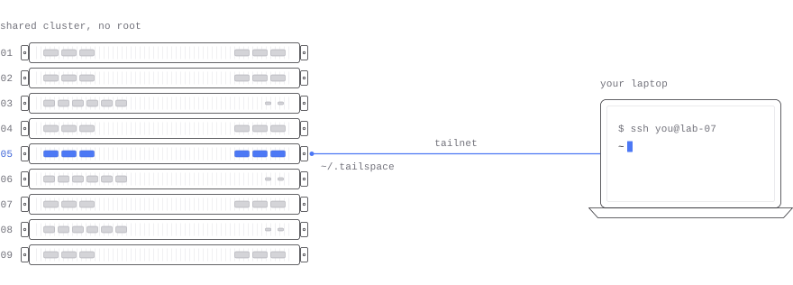

<picture>
  <source media="(prefers-color-scheme: dark)" srcset="assets/logo-dark.svg">
  
</picture>

# Tailspace

**Run Tailscale in Rootless Mode**

Installing [Tailscale](https://tailscale.com) on Linux needs root, which you usually don't have on a shared lab server, an HPC login node or a Kubernetes pod. Tailspace runs Tailscale under your normal account instead, and keeps it running, so you can always SSH into the server from your own devices.

English · [简体中文](README.zh-CN.md)

<picture>
  <source media="(prefers-color-scheme: dark)" srcset="assets/hero-dark.svg">
  
</picture>

## Install

On the server, run:

```bash
curl -fsSL https://raw.githubusercontent.com/ttttonyhe/tailspace/main/tailspace | bash
```

Open the link it prints and log in, the same way you'd add any other device to your tailnet. Once the install finishes, it prints an SSH command you can run from any of your devices.

Tailscale expires device keys after 180 days by default. To keep the server connected for good, [disable key expiry](https://tailscale.com/kb/1028/key-expiry) for it in the admin console.

## What it does

Without root, Tailscale can't run as a system service, so Tailspace looks after it for you:

- Restarts Tailscale if it crashes.
- Starts Tailscale again after the server reboots, right away if the server has cron, or else the next time you log in.
- Switches between a direct connection and your HTTP proxy, if the server has one, whenever either goes down.
- Updates Tailscale daily, and rolls back if a new version doesn't work.
- Stops and tells you why when it needs your help, instead of retrying forever.

It's light, too:

<picture>
  <source media="(prefers-color-scheme: dark)" srcset="assets/metrics-dark.svg">
  
</picture>

## Usage

```bash
tailspace status      # what it's doing, and why
tailspace stop        # stop it, and keep it stopped across reboots
tailspace start       # start it again
tailspace uninstall   # log the server out and remove everything
```

See [ADVANCED.md](ADVANCED.md) for auth keys, proxies, settings, and how it all works.

Tailspace is a single bash script under the [MIT license](LICENSE), and isn't affiliated with Tailscale Inc.
