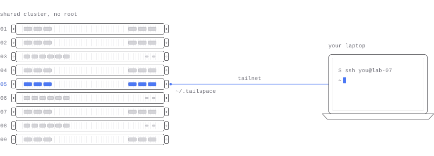

<picture>
  <source media="(prefers-color-scheme: dark)" srcset="assets/logo-dark.svg">
  
</picture>

# Tailspace

**非 Root 身份运行 Tailscale**

在 Linux 上安装 [Tailscale](https://tailscale.com) 需要 root 权限，而在实验室的共享服务器、HPC 登录节点或 Kubernetes Pod 上，你通常没有。Tailspace 用你的普通账号运行 Tailscale，并让它一直运行，你随时都能从自己的设备 SSH 到服务器。

[English](README.md) · 简体中文

<picture>
  <source media="(prefers-color-scheme: dark)" srcset="assets/hero-dark.svg">
  
</picture>

## 安装

在服务器上运行：

```bash
curl -fsSL https://raw.githubusercontent.com/ttttonyhe/tailspace/main/tailspace | bash
```

打开它打印出的链接并登录，就像往 tailnet 里添加其他设备一样。安装完成后，它会打印一条 SSH 命令，在你的任何设备上运行即可连上服务器。

Tailscale 的设备密钥默认 180 天后过期。想让服务器一直保持连接，就在管理后台为它[关闭密钥过期](https://tailscale.com/kb/1028/key-expiry)。

## 它会做什么

没有 root，Tailscale 没法作为系统服务运行，所以由 Tailspace 替你照看它：

- Tailscale 崩溃时，重新启动它。
- 服务器重启后再次启动 Tailscale：有 cron 的服务器上立即启动，否则等你下次登录时启动。
- 如果服务器用 HTTP 代理上网，直连和代理哪个断了，就切到另一个。
- 每天更新 Tailscale，新版本有问题就回滚。
- 遇到需要你处理的问题，停下来告诉你原因，而不是无休止地重试。

而且它很轻：

<picture>
  <source media="(prefers-color-scheme: dark)" srcset="assets/metrics-dark.svg">
  
</picture>

## 用法

```bash
tailspace status      # 在做什么，为什么
tailspace stop        # 停止，服务器重启后也保持停止
tailspace start       # 重新启动
tailspace uninstall   # 让服务器登出，并删除一切
```

auth key、代理、各项设置以及工作原理，见 [ADVANCED.zh-CN.md](ADVANCED.zh-CN.md)。

Tailspace 是一个 bash 脚本，以 [MIT 许可证](LICENSE)发布，与 Tailscale Inc. 没有关联。
